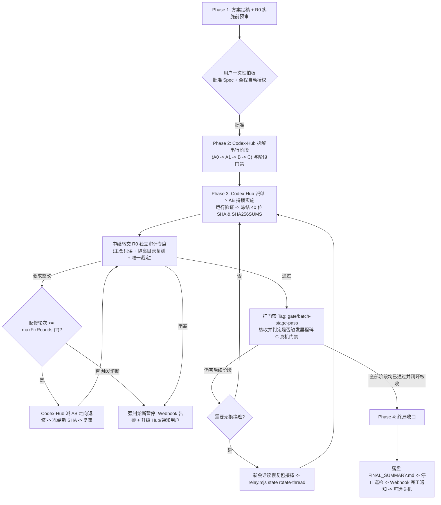

# 规范驱动的跨端多 Agent 分权门禁工作流标准（v1.0）

- **标准全称**：规范驱动的跨端多 Agent 分权门禁工作流（**Spec-Driven Multi-Agent Gated Orchestration Workflow**）
- **日常简称**：`2+3` 规范驱动闭环流程 / SDD 多会话门禁工作流
- **适用范围**：VS Code Codex（WSL 或 Windows 本机）+ Antigravity（总控中继 / 方案中枢 / 独立审计）跨端协同研发长任务
- **版本与状态**：`v1.0`（正式标准，跨项目通用）

---

## §1 核心设计哲学与四大铁律

本标准结合 **SDD（规范驱动开发）**、**Maker-Checker（编审分离门禁流水线）** 与 **Supervisor Relay（总控防停中继模式）**，解决长任务中“Codex 跑完一轮就停”、“长上下文漂移失忆”、“自己写自己审失效”和“无法跨端调度”四大痛点。

1. **磁盘单真源原则（Single Source of Truth）**：「无归档不派单、无落盘回执不流转、无归档结论不算数」。需求方案、执行计划、任务派发、完成回执与审计裁定一律以磁盘约定目录的实体文档及 SHA-256 指纹为准，严禁以口头聊天记录作为施工或验收依据。
2. **零固定目录与零固定会话原则**：本工作流不绑定任何固定项目目录或固定会话 UUID。每个项目独立在自身仓库维护 `.agents/relay.json`（支持在项目任意子目录自动向上发现），各 Codex 角色会话既可留空 UUID 通过 `~/.codex/session_index.jsonl` 按标题动态匹配最新会话，也可通过 `relay.mjs bind` 随时切换绑定，或由 `relay.mjs spawn` 自动拉起全新会话并回写绑定。
3. **职责隔离与编审分离**：写方案、拆任务、写代码、真机测、做审计分属不同独立会话；写代码者不自裁，管分发者不改源码，做中继者不越权。
4. **单一业务写锁 + 实施期单一看板写权限**：主仓库同一时刻仅允许唯一执行专席（`AB`）持锁修改业务代码，提交并冻结完整 40 位 Git SHA 后必须释放写锁；进入实施期后，看板（`DISPATCH_BOARD.md`）与阶段状态仅由 `Codex-Hub` 维护，彻底杜绝双中枢写冲突。
5. **隐私与进程边界红线**：中继只读取 `~/.codex/sessions` 的文件元数据（`mtime` / `size`）与 `~/.codex/session_index.jsonl` 索引元数据，以及 `.agents/development/` 公开协作文档，**严禁读取 Codex 会话对话正文**，严禁泄露或传递 API Key、Token 或未授权私有媒体路径。

---

## §2 `0 + (2+3)` 角色拓扑与严格写入边界

| 层级 | 标准角色名 | 运行载体与存在形态 | 核心职责 | 严格禁止项 | 唯一合法写入边界 |
| :--- | :--- | :--- | :--- | :--- | :--- |
| **第 0 层** | **`Relay Supervisor`（总控中继监工）** | Antigravity 主会话（常驻巡检） | 3 分钟防停巡检、推动停顿 Codex、跨端转交 `R0`/`Hub` 报文、监控子会话健康与熔断阈值、Webhook 告警、收口验收与按授权关机 | **严禁改业务代码**、严禁代填回执、严禁改动 `DISPATCH_BOARD.md` / `STATE.md` / `tasks/*.md`、严禁偷窥 Codex 会话正文 | `.agents/relay/*`（`relay-state.json`、`relay.log`、出站消息队列）及终局授权后的 `FINAL_SUMMARY.md` 索引校验 |
| **中枢 1** | **`Hub`（需求与方案中枢）** | Antigravity 独立会话（按需拉起或与用户直连） | 需求讨论、输出自包含版本化规格书（`Spec`）、熔断根因复盘、处理中途方案变更（`CR`） | 严禁修改业务源码或直接运行改变工作区的构建测试；**进入实施期后不再直接改写 `DISPATCH_BOARD.md`** | `specs/*_SPEC_V*.md`、`DISCUSSIONS.md` |
| **中枢 2** | **`Codex-Hub`（分发与技术中枢）** | VS Code Codex（动态绑定／可换班） | 只读源码研判、把已批准方案拆解为串行阶段、定义阶段范围/禁越界条款/验收门槛、管写锁、核收 `AB`/`C` 回执、内部调度 `AB` 与 `C`、登记跨端审核单 | **严禁直接改业务代码**、严禁运行修改源码/Git 状态的构建命令、严禁改动 `audits/*` 原件或代作 R0 裁定 | `STATE.md`、`DISPATCH_BOARD.md`、`tasks/*.md`（仅派发说明区） |
| **专席 1** | **`AB`（全栈实施与集成专席）** | VS Code Codex（动态绑定／可换班） | 按当前阶段任务卡实施业务代码、强制 **Red → Green TDD（先编写必失败边界/反例测试，再实现转绿）**、冻结完整 40 位 Git Commit SHA、生成 `.agents/evidence/<stage>/SHA256SUMS` 与 `REPRO.md` | 严禁越出本阶段清单、未经门禁放行严禁擅自开启下一阶段、严禁修改 `audits/*` / `ISSUE_LEDGER.md` | 业务代码与仓内工程文档（仅持锁期间）、`tasks/AB-codex.md`（仅回执区）、`AUDIT_QUEUE.md` |
| **专席 2** | **`C`（原生 / 真机环境验证专席）** | 本机终端或独立验证工作树（按需唤醒） | 仅在**里程碑真机门禁**激活：真实 OS 编译（如 Windows MSVC/WebView2）、真实浏览器/GUI、真实外设或受控外部集成验收 | 严禁就地修业务源码（发现缺陷冻结复现日志退回 `AB` 修复） | `tasks/C-desktop.md`（仅实测回执区）、`STATE.md` 桌面/真机独占锁 |
| **专席 3** | **`R0`（独立只读审计专席）** | Antigravity 独立子会话（由中继按需拉起/复用） | ① 实施前方案设计预审（排雷与提炼用户决策）；② 每阶段基于冻结 40 位 SHA 执行 **两段式独立审计**（第一段逐条核对 Spec/`V-xx` 零遗漏 → 第二段开展代码质量与隔离对抗边界复测），发布唯一正式裁定 | **主仓库严格只读**（复测必须 `git archive <sha>` 至临时目录）；严禁覆盖历史审计原件；严禁读取 API Key/私有媒体或发起未授权付费请求 | `audits/design-reviews/*.md`、`audits/<BATCH-ID>/*.md`、`ISSUE_LEDGER.md` |

---

## §3 任务轻重分级（`L1` / `L2` / `L3`）

并非所有改动都需要启动五会话全链路。开干前由中枢或用户先定级：

| 级别 | 触发标准 | 启用角色 | 人工介入与门禁 |
| :--- | :--- | :--- | :--- |
| **`L1` 轻量** | 单点 Bug、明确文案/样式微调、工期 < 2 小时且无跨模块影响 | `AB`（+ 中继防停） | 不写重 Spec，直接描述改动点与自测标准，提交后快速抽检即结项 |
| **`L2` 标准** | 单个完整新功能、半天～1 天交付、影响前后端接口 | `Codex-Hub` + `AB` + `R0` + 中继 | 简明计划确认 1 次；`AB` 冻结 SHA 后交 `R0` 单次独立审计放行 |
| **`L3` 重型闭环** | 多阶段长任务（可跨夜/挂机）、架构升级、数据结构迁移、计费防重、多端联调 | 完整 `0 + (2+3)` | **Phase 1 方案定稿＋预审后人工一次性拍板**；随后自动串行推进至全部阶段闭环并输出 `FINAL_SUMMARY.md` |

---

## §4 L3 长任务标准四阶段生命周期

### 各阶段强制动作清单
- **Phase 1（方案定稿 + 预审拍板）**：
  1. 产出 `specs/<THEME>_SPEC_V0.1.md`；
  2. 对 `L3` 任务，由 `R0` 进行实施前预审（输出至 `audits/design-reviews/`），识别 P0/P1 隐患并提炼少量需人工裁决项；
  3. 整合补齐为 `[已批准方案·本次执行依据]` 版本（如 `V0.3`），用户仅需此时确认一次：批准方案版本、是否允许全程阶段间自动续推、是否开启完工自动关机与 Webhook 告警。
- **Phase 2（中枢拆解与门禁定义）**：
  - `Codex-Hub` 将批准方案拆成可独立提交与验收的串行小阶段（通常每阶段控制在 1–3 小时以内可验证闭环），并按顺序赋唯一编号（预审 `T-00`，实施 `T-01`、`T-02`…，任务名称末尾必须显式附带编号如 `<任务名> [T-01]`，派生单据使用 `T-01-R0` / `T-01-FIX1` / `T-02-C`）。
  - 每个阶段任务卡必须写死：**纳入范围、显式禁止越界范围、本阶段离线验收命令与反例计数要求、下一阶段准出门禁（Gate）、涉及变更的 `R0` 历史追踪编号**。
- **Phase 3（自动循环推进）**：
  - `AB` 完工并冻结 40 位 SHA 后释放写锁 → `Codex-Hub` 核对文件数/diff/证据指纹后在 `tasks/R0-review.md` 登记 `发送到：Antigravity`（`待转交`）→ 中继拉起 `R0` 审计 → `R0` 落盘新报告（绝不覆写前轮报告）并给唯一结论：`通过` / `要求整改` / `阻塞`。
  - 中继回传报告路径、报告 SHA-256 与唯一结论给 `Codex-Hub` 核收。
- **Phase 4（终局收口）**：
  - 所有阶段均为 `通过` 且 `Codex-Hub` 在看板标记全部闭环完成、无未释放写锁 → 核实 `FINAL_SUMMARY.md` 已落盘 → 停掉 3 分钟巡检 Cron → 触发完工通知 → 按授权执行汇报或倒计时关机。

---

## §5 六环节强制落盘与随单文档包（Context Pack）协议

1. **六环节双向归档**：
   - ① 讨论 → `DISCUSSIONS.md`
   - ② 方案 → `specs/*_SPEC_V*.md`（版本递增，严禁覆盖旧版）
   - ③ 计划 → `STATE.md` + `DISPATCH_BOARD.md`
   - ④ 任务 → `DISPATCH_BOARD.md` + `tasks/<角色>.md`
   - ⑤ 执行 → `tasks/*.md`（回执区）+ `AUDIT_QUEUE.md` + 仓内 `OPERATIONS.md`
   - ⑥ 审计 → `audits/**/*.md` + `ISSUE_LEDGER.md`（原件只读不改）
2. **随单文档包（Context Pack）四硬规**：
   - **背景摘要 + 5 选 1 效力标签**：每份引用文档必须标注 `[讨论草案·未授权实施]` / `[设计预审·待拍板]` / `[已批准方案·本次执行依据]` / `[冻结基线·只读对照]` / `[权威审计裁定]`。
   - **同机精确路径 + 锚点 + 指纹**：给出准确路径（跨 WSL/Windows 附对应路径）、章节锚点及 40 位 Git SHA 或 SHA-256 摘要，禁止全量硬粘贴数千行无关历史。
   - **跨环境不可直读附脱敏内联正文**：若 `.agents/` 被 `.gitignore` 忽略且目标运行在无共享目录的独立 Bundle/沙箱中，随报文末尾附核心必需条款的脱敏完整正文。
   - **刚性脱敏红线**：任何文档与报文中严禁出现真实 API Key、Token、鉴权链接或私有未授权媒体正文。

---

## §6 七大高可用与风控硬保障

### 1. 返修死循环熔断（Fix-Loop Circuit Breaker）
- 单阶段默认最大返修轮次 **`maxFixRounds = 2`**（即最多允许 `FIX1` 和 `FIX2` 两次返修）。
- 若第 `2` 轮返修后 `R0` 复审结论仍为 `要求整改`，系统**禁止自动再派第 3 轮返修**：`relay.mjs state finish-review` 会自动置位 `fixCapBreaker = true`，巡检立即暂停自动推进，向用户发出 `circuit_breaker` 告警，并建议升级由 `Hub` 介入根因/方案评估。

### 2. 长会话上下文“无损换班”（Session Rotation）
- Codex 单会话连续运行超过 **1～2 个大阶段** 或明显出现推理变慢/多次压缩/遗忘边界时，主动执行无损换班：
  1. 确保当前持锁任务已冻结提交并释放写锁；
  2. 新开干净的 VS Code Codex 会话作为新的 `Codex-Hub` 或 `AB`，让其执行冷启动只读检查清单（`STATE.md` + `DISPATCH_BOARD.md` + 最新 `[已批准方案]` + 上一门禁通过 SHA/Tag + `ISSUE_LEDGER.md`）；
  3. 运行 `relay.mjs state rotate-thread --role <hub|ab> --thread <new-uuid>` 自动更新 `.agents/relay.json` 与 `.agents/relay-state.json` 并清空旧计数，无缝继续。

### 3. 实施中途需求/方案变更规则（Mid-Flight Spec Change Request）
- 严禁在未改 `Spec` 时直接口头给 `AB` 加减功能（否则 `R0` 依据旧 `Spec` 必打回）。
- 中途发现方案不可行或用户新增需求，必须按以下顺序流转：
  1. 中继暂停当前阶段自动派单；
  2. 由 `Hub` 评估影响，套用 `resources/CR_DELTA.md.template` 起草轻量增量变更提案（`CR-xx`，列明 `ADDED` / `MODIFIED` / `REMOVED` Diff 与受影响 `V-xx`/反例），批准后新增递增版本方案（如 `V0.3 → V0.4`）；
  3. `Codex-Hub` 更新看板待办、重置受影响阶段，将新版 `Spec` 路径与新 SHA-256 指纹纳入下一张任务卡的 Context Pack；
  4. 用户确认变更单后通过 `relay.mjs analyze --json` 复检，重新放行自动循环。

### 4. 挂机容灾、子会话监控与主动告警
- **状态全外置**：中继进度全部持久化在 `.agents/relay/relay-state.json`（包含当前绑定角色最后写入时间、最近快照指纹、连续无进展推送次数、各阶段返修计数、已处理跨端单号与活跃审查子会话 ID）。任何时候进程重启或模型切换，均只需读取 `relay-state.json` 即可秒级恢复。
- **双监控**：每 3 分钟巡检除监控 Codex 线程 `mtime` 外，同时调用 `manage_subagents{Action:"list"}` 检查正在审计的 `R0` 子会话；若发生 `429` 配额耗尽或异常停止且输出未落盘，第一时间捕获并切换/新建子会话或发告警。
- **主动 Webhook 告警**：在 `circuit_breaker`、`blocker`、`quota`、`complete` 四类事件时，通过 `relay.mjs notify` 自动向飞书 / 企业微信 / 钉钉 / 通用 HTTP Webhook 推送告警（URL 优先读取环境变量，严禁明文入库）。

### 5. 「阶段离线门禁」vs「里程碑真机门禁（`C`）」分层
- 阶段推进快但避免“全篇通过却在最终真机崩盘”的原则：
  - **阶段离线门禁（`AB` + `R0`）**：负责编译检查、逻辑单测、交叉编译检查、本地受管合成 UI 与环回 Mock 验收。
  - **里程碑真机门禁（`C`）**：在 `Spec` 立项时即显式标注哪几个里程碑（例如基础设施与核心链路首次合龙、终局全功能合龙前）必须唤醒 `C` 在真实目标 OS/真机桌面/受控外设下执行真机冒烟，将真机兼容性问题（如 Windows 文件权限、WebView2 CSP、路径长度/编码等）前移消化。

### 6. Git 分支隔离、门禁 Tag 与不可逾越红线
- **独立分支**：所有 `L2/L3` 长任务原则上从主分支切出独立特性分支（如 `feat/<BATCH-ID>`）推进；`Hub`/`R0`/中继脚本与状态文件统一收敛在 `.agents/relay/` 且在 `.gitignore` 忽略，保持工作树高度纯净（降低 `DIRTY` 噪音与误提交）。
- **门禁 Tag 与提交前缀**：每次实施/返修 Git 提交信息带任务号前缀（如 `feat(T-01): ...`、`fix(T-01-FIX1): ...`）；每通过一次 `R0` 阶段审定，在通过提交上打轻量 Tag `gate/<BATCH-ID>-T-01-pass`，支持随时回退对照。
- **高危红线清单（无人值守绝对禁止）**：
  1. 禁止执行 `git push --force`、`git reset --hard` 丢弃他人提交或删除非 `/tmp` 目录文件；
  2. 禁止自动向远程生产库合并、发布正式版本或未授权调高付费 API 预算；
  3. 禁止读取 `.env` / 密钥文件并写入任何日志、报文或审阅报告；
  4. 禁止在未确认看板全部闭环且 `FINAL_SUMMARY.md` 落盘前执行系统关机。

### 7. 终局交付简报与安全关机协议
- 若用户预先指定“全部完成后关机”（`shutdownOnComplete.enabled: true`）：
  1. 确认 `A0..最终阶段` 均已由 `R0` 签发 `通过` 且 `Codex-Hub` 已在看板标记全方案完成、写锁全部释放；
  2. 确认 `<devDir>/../FINAL_SUMMARY.md`（或项目指定位置）已完整落盘；
  3. 终止 Antigravity 定时巡检 Cron；
  4. 调用 `relay.mjs notify --event complete` 发送终局简报摘要与 SHA 清单；
  5. 向用户输出最终书面汇总，随后执行带缓冲撤回窗口的定时关机指令（默认 120 秒：`shutdown.exe /s /t 120 /c "..."`，用户随时可 `shutdown /a` 取消）。

---

## §7 防停推动规则与标准阈值矩阵

| 参数 / 规则 | 默认值 / 触发条件 | 动作 |
| :--- | :--- | :--- |
| `pollIntervalSec` | `180` 秒（`*/3 * * * *`） | 定时拉取 `relay.mjs status` 与子会话列表 |
| `idleThresholdSec` | `180` 秒 | Codex 会话滚动文件 `idle_seconds < 180` 判为运行中（不打扰）；`>= 180` 判为本轮已停 |
| 重复推送防护 | 对比 `lastPushThreadWrite` | 同一线程自上次推送后 `last_write` 无任何刷新，说明队列尚待消化，**严禁重复推送** |
| `maxNoProgressPushes` | `3` 次 | 对同一线程连续推动 3 次后，看板、任务卡与 Git HEAD 仍均无变化 → **触发无进展熔断并告警用户** |
| **规则 a（`AB` 中途停）** | `AB` 停且当前认领单尚无冻结 SHA 完成回执 | 推 `AB` 继续完成当前任务、冻结 SHA 并写回执 |
| **规则 b（`AB` 完工 `HUB` 停）** | `AB` 停且已交回执、`HUB` 停且看板未核收 | 推 `HUB` 核收、更新看板并登记下一阶段或跨端 `R0` 审核 |
| **规则 c（`HUB` 派新单 `AB` 未接）** | `HUB` 已发新派单、`HUB` 与 `AB` 均停且 `AB` 未接棒 | 推 `AB` 接棒执行新单 |
| **规则 d（双停且指向不明）** | `AB` 与 `HUB` 均停且看板状态模糊/疑有隐性阻塞 | 推 `HUB` 核对看板继续派发或明确写明阻塞原因与责任方 |
| **规则 e（单方工作中静默）** | 任一方处于运行中（`idle_seconds < 180`） | 保持安静不打扰，仅在规则 a（`AB` 自身停于未完成任务且正在等待之外）例外 |
| **后台长命令与孤儿进程甄别（`ppid` 溯源）** | 怀疑 `STOPPED` 会话仍在跑编译/测试子进程 | 必须运行 `relay.mjs procs --json`（或 `status --check-procs`）沿 `ppid` 溯源：仅当 `hasActiveCodexWorker=true`（仍挂在存活 `codex` 宿主下）才暂缓唤醒；孤儿进程（父 `codex` 已死、挂至 `PID 1`）不得阻断防停唤醒 |
| **投递未消费回声验收（1 周期告警）** | 推完消息（尤其含 `could not resume thread`）满 `pollIntervalSec` 后目标线程仍无新写入 | 在 `status` 与 `telemetryLine` 立即输出 `▲ **投递消息疑似未消费**` 明确提醒用户切过去点活对应会话，不再默默空等；处理后可 `state ack-alert --kind unconsumed` 消警 |
| **WSL / 宿主环境重启感知** | 探测到 `boot_id` 变化或运行时间 `uptime` 缩短回退 | 第一时间输出 `▲ **检测到运行环境刚重启**` 提醒用户将 `Codex-Hub` 与 `AB` 窗口点活；全部绑定角色产生新写入后自动消警（或手动 `state ack-alert --kind restart`） |

---

## §8 `v1.3.0` 黄金三角增强机制（防返修、防腐化、事件驱动）

1. **防漂移开工前体检（`relay.mjs analyze`）**：派单开工前执行只读体检，拦截缺失 `V-xx`、未拍板 `PD-xx`、看板重号、缺失 `[T-xx]`、断链文件、超上下文预算与未解除熔断（发现阻断错误即返回非 `0` 退出码），并在 `runtime="wsl"` 下自动检测 `/mnt/<drive>/` 跨盘 9P/DrvFS 高频 I/O 风险（`WSL_DRVFS_IO_RISK`）；配合 `cli.mjs doctor` 自动核查 Windows 动态短端口池容量与 `.wslconfig` `mirrored` 冲突风险。
2. **波次并行与多 Worktree 调度（Wave）**：看板任务总表通过 `波次/依赖` 列（`W0`、`W1`、`W2（依赖 T-01）`）声明可并行波次，`status` 自动汇总 `waves.currentWave` 与 `waves.parallelReady`，配合多 `git worktree` 让无依赖子任务并发推进。
3. **上下文预算监控与日志归档（`relay.mjs compact`）**：按 `contextBudgets`（默认 `stateMaxLines: 120`、`boardMaxLines: 160`、`taskCardMaxLines: 250`）持续监控协作文档膨胀，支持 `--dry-run` 预警与 `--apply` 将超长历史调度日志安全归档至 `.agents/development/archive/` 并留 1 行索引。
4. **零依赖事件信号总线与阶段耗时追踪（`relay.mjs event` & `stageTimers`）**：角色完工、阻塞或送审时可选向 `.agents/relay/events.jsonl` 发射结构化信号（`done`/`blocked`/`review_ready`/`heartbeat`/`decision_needed`），巡检人话卡片最高优先展示 `◆ **收到事件信号**` 并累计各阶段耗时。
5. **零依赖离线 HTML 驾驶舱（`relay.mjs ui`）**：支持 `--export <file.html>` 导出零外链单文件中文全景驾驶舱，或本地 `--port 4317` 启动每 5 秒轮询 `/api/status` 的实时网页。
